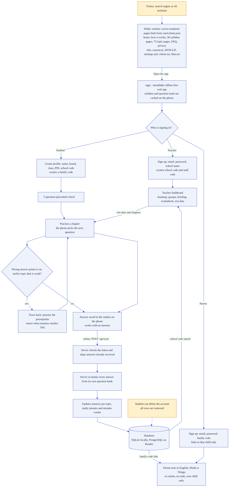
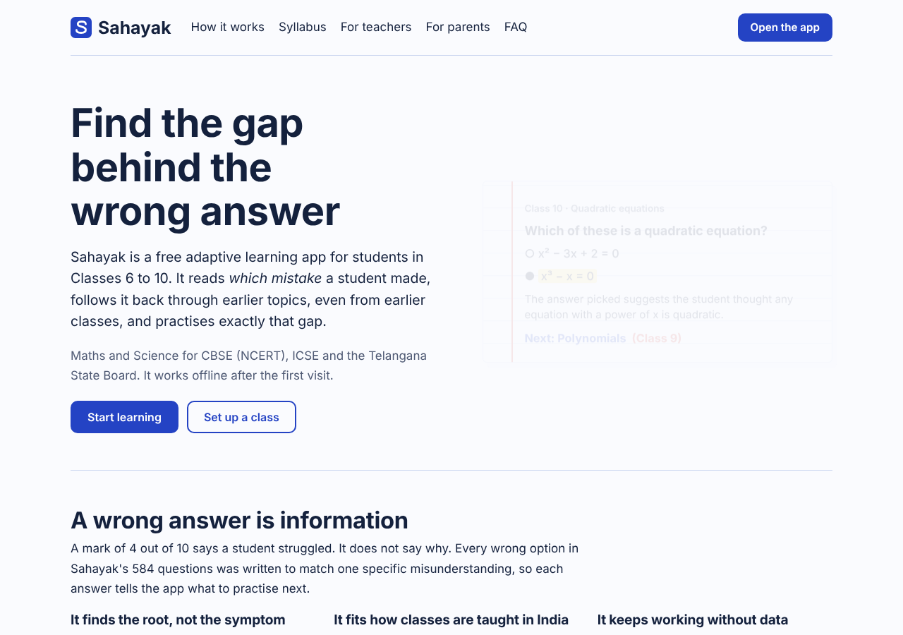
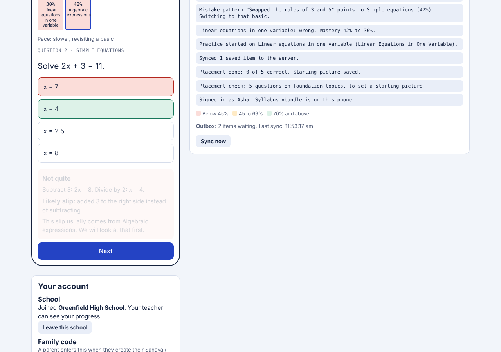
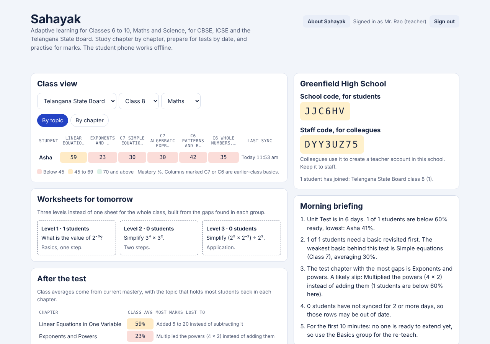
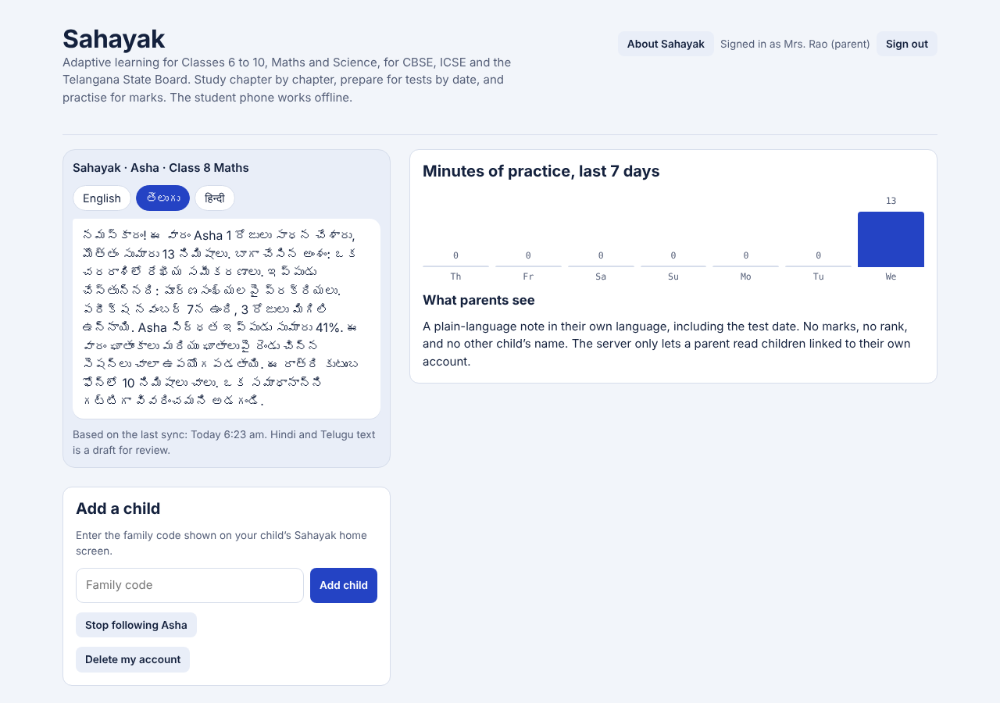

# Sahayak

**Find the gap behind the wrong answer.** Adaptive learning for Classes 6 to 10 (Maths and Science) for CBSE (NCERT), ICSE and the Telangana State Board.

Built by **Team WIN R**, Gokaraju Lailavathi Engineering College, for **Code Kernel '26** (Adaptive Learning for Classes 6 to 10).

| | |
|---|---|
| **Live site** | https://sahayak-ypqu.onrender.com (free tier: the first request after idle can take about a minute) |
| **App** | https://sahayak-ypqu.onrender.com/app/ |
| **Flowchart** | [docs/flowchart.png](docs/flowchart.png) (source: [docs/flowchart.mmd](docs/flowchart.mmd)) |
| **Architecture** | [docs/architecture.png](docs/architecture.png) |
| **Round 2 demo video** | [demo/sahayak_demo.mp4](demo/sahayak_demo.mp4) (recorded before the Round 3 changes below) |



## What changed in Round 3

1. **Real data only.** No demo accounts, no sample classmates, no code shown on screen. The live site starts empty and everything in it was typed by a real user. Sample data exists only for tests and `SEED_DEMO=1` on a developer machine, and the server deletes any such rows on start when it is off (`purge_demo`, tested).
2. **Real accounts.** Teachers and parents sign up with email and password (PBKDF2 hashed, lock-out after 5 misses). The console "one-time code" was a simulation, so it was removed rather than faked.
3. **Real school flow.** A teacher creates a school and gets a **school code** (for students) and a **staff code** (for colleagues). A student enters the school code at sign-up, or later from the home screen, and appears on that teacher's dashboard. A school's teachers see only that school's students.
4. **Real parent link.** Each student has a **family code**. A parent signs up with it and sees a note about that child only. The student can rotate the code or remove all parents.
5. **Public website with SEO, AEO and GEO** (below), served from the same FastAPI app at `/`. The app moved to `/app/`.
6. **Product quality:** delete-account for every role, contact form stored in the database (honeypot and rate limit), empty states that say what to do next, form values kept after an error, schema upgrade for databases made by the earlier version.

## SEO, AEO and GEO

Every public page is server-rendered HTML (no JavaScript needed to read it), generated from the real curriculum data: 10 general pages, 30 syllabus pages (board x class x subject) and **73 topic pages**, 113 URLs in `sitemap.xml`.

| Technique | Where |
|---|---|
| **SEO:** one H1, unique title and description, canonical URL, Open Graph and Twitter tags, breadcrumbs, semantic landmarks, skip link, fast static-style pages with cache headers, `sitemap.xml`, `robots.txt`, helpful 404, app kept out of the index (`noindex`) | `backend/app/web.py`, `backend/app/templates/` |
| **AEO (answer engines):** the answer comes first on each page; a `FAQPage` with 12 questions whose JSON-LD matches the visible text; "What is X?" and "What should I know before X?" answers on every topic page | `/faq`, `/topics/<id>` |
| **GEO (AI assistants):** `llms.txt` (summary and key pages) and `llms-full.txt` (all 73 topics as plain text), explicit allow rules for GPTBot, ClaudeBot, PerplexityBot, Google-Extended and others, structured data (`Organization`, `WebSite`, `WebApplication`, `LearningResource`, `FAQPage`, `TechArticle`, `ItemList`, `BreadcrumbList`), plus an honest "what is not proven yet" page that models can quote accurately | `/llms.txt`, `/about` |

Set `SITE_URL` to your public address so canonical links and the sitemap use it.

## The idea

A student stuck on *linear equations in Class 8* is very often stuck on *integers from Class 6*. Teachers with 40 students cannot see that. Sahayak:

1. keeps **one prerequisite graph** (73 topics, Classes 6 to 10, Maths and Science) and maps each board's chapters onto it, so gaps from earlier classes are found whichever board the student is on;
2. tags **every wrong option with the mistake it shows**. A wrong answer is read as a *pattern*, and the engine follows it back through the graph to the weak basic, teaches that, then returns;
3. runs **offline on the phone**. Answers are saved first and synced when a connection exists; the **server re-marks every answer** and holds the authoritative mastery;
4. gives teachers a **morning briefing**, groups, three-level worksheets and a test the whole class prepares for, and gives parents a **plain weekly note in English, Hindi or Telugu**.

| Public site | Student | Teacher | Parent (Telugu) |
|---|---|---|---|
|  |  |  |  |

## What is in the box

- **Backend** (`backend/app`): FastAPI, SQLAlchemy 2.0 (SQLite locally, PostgreSQL on Render via `DATABASE_URL`), JWT sessions, hashed PINs and passwords.
- **Engine** (`backend/app/engine`), pure Python with no I/O: prerequisite graph, damped BKT mastery, practice with trace-back, revision planner, mock tests marked by step, teacher groups/briefing/worksheets, multilingual parent note.
- **Public website** (`backend/app/web.py`, `templates/`, `static/`): Jinja2 pages, sitemap, robots, llms.txt.
- **Web app** (`frontend`, served at `/app/`): installable PWA, no build step. Runs the same engine in JavaScript so practice works with no network, with an outbox, service worker and offline PIN check.
- **Content** (`content_src` to `backend/data/curriculum.json`): 73 topics, 584 questions with tagged distractors, chapter maps for three boards.
- **Tests**: 72 pytest tests (engine, API, accounts, site) and a real-browser end-to-end script that creates everything through the screens.

## Run it

Needs Python 3.11 or newer.

```bash
pip install -r backend/requirements-dev.txt
cd backend && uvicorn app.main:app --reload --port 8000
# site:  http://localhost:8000      app: http://localhost:8000/app/

# or Docker with PostgreSQL
docker compose up --build
```

The database starts empty. In the app: **Teacher > Create account** (you get a school code), then on another profile **Student > New profile** with that code, then **Parent > Create account** with the student's family code. `run_phone.bat` / `run_phone.sh` do the same on your Wi-Fi so a phone can open the app.

Developer-only sample class (never on a live site): `SEED_DEMO=1`, then teacher `teacher@demo.sahayak.local` / `demo-password-1`.

### Try it on a phone

`127.0.0.1` always means "this computer". Put phone and PC on the same Wi-Fi, run `run_phone.bat` (Mac/Linux: `./run_phone.sh`) and open `http://<PC's IPv4 address>:8000/app/`. Plain `http://` addresses are not a secure context, so the service worker is off there: everything works online and the PIN is still checked offline, but opening the page itself with no connection needs https (the Render site is https).

## API

Interactive docs at `/docs`. All under `/api`, bearer token unless noted.

| Area | Endpoints |
|---|---|
| Auth | `POST /auth/register-student`, `/auth/register-teacher`, `/auth/register-parent`, `/auth/student/login`, `/auth/login` (teacher or parent), `GET /auth/me`, `DELETE /auth/me` |
| Student | `GET/PATCH /student/me`, `POST /student/join-school`, `DELETE /student/school`, `POST /student/link-code`, `DELETE /student/parents`, `GET /student/plan`, `GET /student/mock`, `POST /student/mock/submit`, **`POST /sync`** |
| Teacher | `GET /teacher/school`, `GET /teacher/class`, `PUT /teacher/test`, `PUT /teacher/group`, `POST /teacher/assign` |
| Parent | `GET /parent/children`, `POST /parent/children`, `DELETE /parent/children/{id}`, `GET /parent/note?student_id=&lang=en\|hi\|te` |
| Content | `GET /content/bundle` (ETag), `/content/chapters`, `/content/topics/{id}`, `/content/version` |
| Other | `POST /feedback` (contact form), `GET /health` |

### Sync, in one paragraph

The phone sends events such as `{cid, type:"answer", qid, pick:"<option text>", ts}`, never "I was right". The server marks each against the curriculum, applies them in time order to the stored mastery, clamps bad phone clocks, ignores a `cid` it has seen (so retries are safe), and replies with the authoritative mastery. The phone rebases onto it and keeps anything still unsent.

## Data and privacy

Stored: student first name, board, class, language, hashed PIN, answers with times, mastery, study minutes, school joined, family code; teacher and parent name, email, hashed password; contact messages. Not collected: phone numbers, surnames, photos, location. No cookies, no ads, no analytics. Full table on the `/privacy` page. Students can delete their account and all answers; teachers and parents can delete theirs.

Security: PBKDF2-hashed secrets, lock-out after 5 wrong PINs or passwords, identical error for unknown email and wrong password, roles enforced on every route, teachers scoped to their school, a parent can read only linked children and the note has no marks or rank, server re-marks every answer.

Admin commands: `python -m app.cli stats | feedback | purge-demo | check-content`.

## Tests

```bash
cd backend && python -m pytest -q                       # 72 tests
python scripts/build_curriculum.py --check              # committed curriculum matches content_src
node scripts/e2e.js http://localhost:8000               # real browser, empty database
```

The e2e script walks the whole product through the screens: public pages, teacher sign-up, a new school starting empty, a student joining with the code, placement, practice, offline outbox and sync, a mock test, the teacher seeing the student, setting a test date and sending practice, a parent linking with the family code (Telugu and Hindi notes), the student seeing one parent follow, and account deletion.

## Deploy (Render)

`render.yaml` creates a Docker web service and a Postgres database, generates `SECRET_KEY` and sets `SITE_URL`. Change `SITE_URL` to your own address. On start the app creates missing tables and columns and removes any demo rows left by an earlier version. Free tier notes: the service sleeps when idle (first request is slow) and free Postgres databases expire after 30 days, so back up or upgrade before relying on it.

## Honest limits

- Mastery uses a damped BKT model with fixed parameters. It is **not fitted** to real student data and no classroom trial has been run.
- Questions and lessons were written for this project and checked in a blind review of answer keys; a teacher should still review them. Chapter lists came from public pages and need a yearly check.
- **Hindi and Telugu** text is a draft for native-speaker review. Questions are English only.
- Passwords have no "forgot password" email yet (that needs an email service). A teacher or parent who forgets one must create a new account.
- Only multiple-choice questions, plus step-marked parts for 20+ Maths topics. No progressive hints during a question.
- No Alembic migrations: `ensure_schema()` adds the few new columns. Tests run on SQLite; the live site runs on PostgreSQL.

## Layout

```
backend/app/        main.py, web.py, routers/, services/, engine/, templates/, static/, models.py, security.py, seed.py (dev only), cli.py
backend/data/       curriculum.json (generated)
backend/tests/      engine, API, accounts, site, content, JS/Python parity
content_src/        authored topic packs and board chapter maps
frontend/           app shell served at /app/: index.html, js/{boot,api,engine,app}.js, sw.js, manifest.json
scripts/            build_curriculum.py, e2e.js, js_parity.js, record_demo.js (Round 2 video)
docs/               flowchart.png/.mmd, architecture.svg/png, INTERVIEW_PREP.md, screenshots
```

MIT licence.
