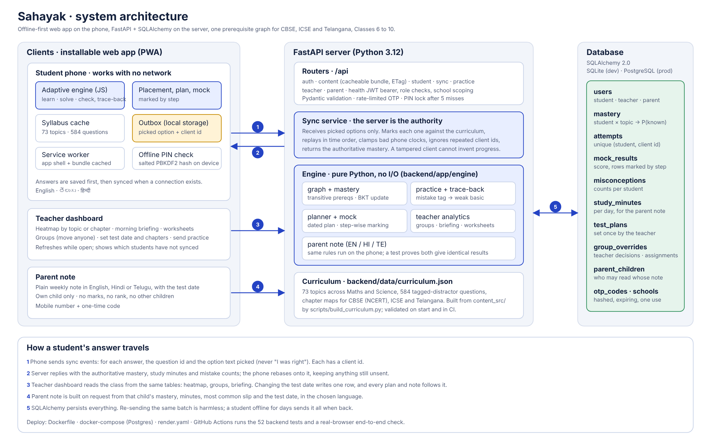

# Sahayak

**Find the gap behind the gap.** Adaptive learning for Classes 6 to 10 (Maths and Science) for CBSE (NCERT), ICSE and the Telangana State Board.

Built by **Team WIN R**, Gokaraju Lailavathi Engineering College, for **Code Kernel '26** (X-Kernel, GRIET Hyderabad, with Canvas Classes). Problem: *Adaptive Learning for Classes 6 to 10*.

| | |
|---|---|
| Demo video (2:47) | [`demo/sahayak_demo.mp4`](demo/sahayak_demo.mp4) |
| Architecture diagram | [`docs/architecture.png`](docs/architecture.png) · [`.svg`](docs/architecture.svg) |
| Deployed link | none yet: see [Deploy](#deploy) (one-click `render.yaml` included) |



## The idea

A student stuck on *linear equations in Class 8* is very often stuck on *integers from Class 6*. Teachers with 40 students cannot see that. Sahayak:

1. keeps **one prerequisite graph** (73 topics, Classes 6 to 10, Maths and Science) and maps each board's chapters onto it, so gaps from earlier classes are found whichever board the student is on;
2. tags **every wrong option with the mistake it shows**. A wrong answer is read as a *pattern*, and the engine follows it back through the graph to the weak basic, teaches that, then returns;
3. runs **offline on the phone**. Answers are saved first and synced when a connection exists; the **server re-marks every answer** and holds the authoritative mastery;
4. gives teachers a **morning briefing**, groups, three-level worksheets and a test the whole class prepares for, and gives parents a **plain weekly note in English, Hindi or Telugu**.

| Student | Teacher | Parent (Telugu) |
|---|---|---|
|  |  |  |

## What is in the box

- **Backend** (`backend/app`): FastAPI, SQLAlchemy 2.0 (SQLite by default, PostgreSQL via `DATABASE_URL`), JWT sessions, hashed PINs/OTPs.
- **Engine** (`backend/app/engine`), pure Python with no I/O: prerequisite graph, BKT-style mastery, practice with trace-back, revision planner, mock tests marked by step, teacher groups/briefing/worksheets, multilingual parent note.
- **Web app** (`frontend`): installable PWA, no build step. Runs the same engine in JavaScript so practice works with no network, with an outbox, service worker and offline PIN check.
- **Content** (`content_src` to `backend/data/curriculum.json`): 73 topics, 584 questions with tagged distractors, 111 step-marked parts, chapter maps for three boards. A blind review of the answer keys found no genuine errors after one fix.
- **Tests**: 52 pytest tests and a real-browser end-to-end script.

## Run it

```bash
# local (Python 3.11+)
pip install -r backend/requirements-dev.txt
cd backend && uvicorn app.main:app --reload --port 8000
# open http://localhost:8000

# or Docker with PostgreSQL
docker compose up --build
```

Demo accounts (created when `SEED_DEMO=1`, the default):

| Role | Sign in with |
|---|---|
| Student **Ravi K.** (Telangana, Class 8) | pick the profile, PIN `1234` |
| Teacher **Ms. Lakshmi** | mobile `90000 00002`, then the code shown on screen |
| Parent of Ravi | mobile `90000 00003`, then the code shown on screen |

The code is shown on screen only because `SMS_BACKEND=console`. In production set `SEED_DEMO=0`, a real `SECRET_KEY`, and plug an SMS provider into the OTP request (`backend/app/routers/auth.py`).

Suggested tour: sign in as Ravi, run the placement check, practise a chapter and get a wrong answer (watch the engine go back to a basic), switch the phone **Offline**, answer more, go **Online** (the outbox drains), take a mock. Then sign in as the teacher (Ravi's row updates, move the test date, send practice) and as the parent (the note follows the new date).

## API

Interactive docs at `/docs`. All under `/api`, bearer token unless noted.

| Area | Endpoints |
|---|---|
| Auth | `POST /auth/register-student`, `/auth/student/login`, `/auth/otp/request`, `/auth/otp/verify`, `GET /auth/me` |
| Content | `GET /content/bundle` (ETag), `/content/chapters`, `/content/topics/{id}`, `/content/version` |
| Student | `GET/PATCH /student/me`, `GET /student/plan`, `GET /student/mock`, `POST /student/mock/submit`, **`POST /sync`** |
| Practice (online, for thin clients) | `POST /practice/next`, `POST /practice/answer` |
| Teacher | `GET /teacher/class`, `PUT /teacher/test`, `PUT /teacher/group`, `POST /teacher/assign` |
| Parent | `GET /parent/children`, `GET /parent/note?student_id=&lang=en|hi|te` |

### Sync, in one paragraph

The phone sends events such as `{cid, type:"answer", qid, pick:"<option text>", ts}`, never "I was right". The server marks each against the curriculum, applies them in time order to the stored mastery, clamps bad phone clocks, ignores a `cid` it has seen (so retries are safe), and replies with the authoritative mastery. The phone rebases onto it and keeps anything still unsent.

## Security and privacy

PINs and OTPs are PBKDF2-hashed; five wrong PINs lock a profile for five minutes; OTPs expire in five minutes, are single use, attempt-limited and rate-limited, and the request response is identical whether or not the number exists. Roles are enforced on every route and teachers are scoped to their school. A parent can only read children linked to their account, and the note has no marks, no rank and no other child's name. Students are asked only for a first name, board, class and language.

## Tests

```bash
cd backend && python -m pytest -q          # 52 tests
python scripts/build_curriculum.py --check # committed curriculum matches content_src
node scripts/e2e.js http://localhost:8000  # real browser: sign-in, offline, sync, teacher, parent
```

Covered: engine rules (mastery, trace-back, level choice, no repeated questions, plan order, step marking, groups, briefing, parent note in 3 languages), API auth (lockout, OTP expiry/reuse/rate limit, role separation, token expiry), **sync** (forged claims change nothing, idempotent replay, time ordering, future clocks), teacher and parent isolation, content integrity, and a **parity test that runs the phone engine in Node and checks it matches the Python engine** exactly. CI (`.github/workflows/ci.yml`) runs all of it.

## Deploy

`Dockerfile`, `docker-compose.yml` (with PostgreSQL) and `render.yaml` are included. On Render: **New > Blueprint**, pick this repo. It builds the Docker image, creates a Postgres database and generates `SECRET_KEY`. For a real school, set `SEED_DEMO=0`, create staff with `python -m app.cli add-teacher NAME MOBILE SCHOOL_CODE`, and wire an SMS provider.

## Honest limits

- **No deployed URL yet.** The project was built in a sandbox that cannot host a service. Everything needed to deploy is in the repo.
- PostgreSQL support is written and configured but was **tested only against SQLite** here.
- Tables are created at start (no Alembic migrations yet).
- **Hindi and Telugu** text (topic names, parent note) is a draft and needs a native speaker's review.
- **Chapter lists** were gathered from public pages and need a teacher's check; the board maps cover the important chapters, not every one.
- Questions are multiple-choice; the 3-mark step questions exist for 20+ Maths topics, not all.
- Mastery uses a damped BKT model with fixed parameters; it is not fitted to real student data.

## Layout

```
backend/app/        main.py, routers/, services/, engine/, models.py, security.py, seed.py, cli.py
backend/data/       curriculum.json (generated)
backend/tests/      engine, API, content, JS/Python parity
content_src/        authored topic packs and board chapter maps (source of curriculum.json)
frontend/           index.html, js/{boot,api,engine,app}.js, sw.js, manifest.json
scripts/            build_curriculum.py, e2e.js, record_demo.js, js_parity.js
docs/               architecture.svg/png, screenshots
demo/               sahayak_demo.mp4
```

MIT licence.
